# IEC 61850 Service Studio：IED 服务仿真与报文诊断桌面平台

IEC 61850 Service Studio 是一款运行于 Windows 的桌面 IED 服务端工程工具。它把模型导入、MMS 服务、运行值仿真、报告与控制、GOOSE/SV 发布、TLS、定值组管理和报文分析集中在同一工作区中，适合实验室联调、客户端验证、模型检查和通信问题复现。

应用使用真实的 libiec61850 协议栈提供通信服务。桌面界面负责工程配置和运行监视，C++ 后端持有 IEC 61850 数据模型并处理网络交互，报文分析运行在独立进程中。各部分通过明确接口协作，模型配置、实时状态和捕获证据相互独立。

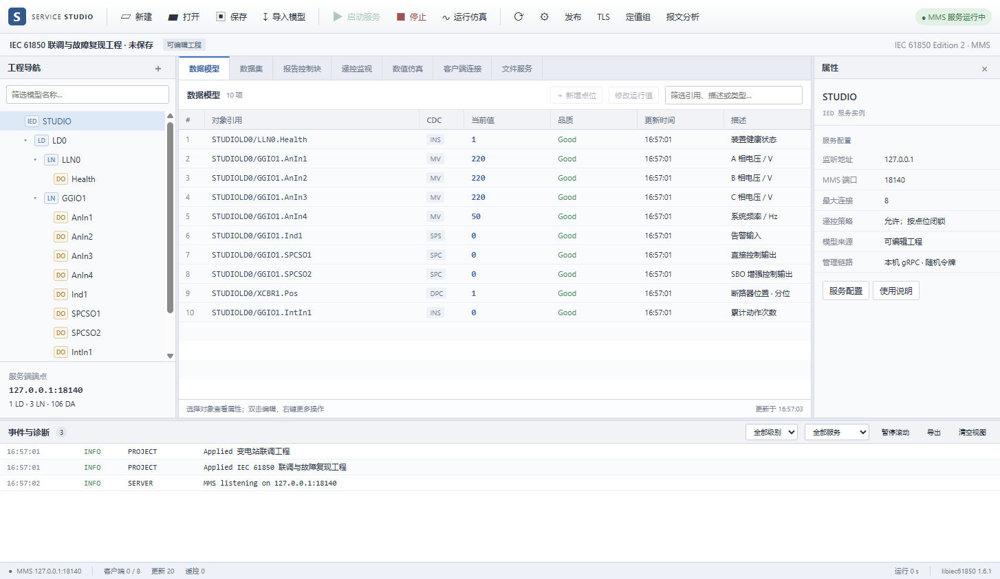

## 产品能力

### 工程与模型管理

Service Studio 使用 `.i61850` 文件保存工程。工程包含 IED 名称、监听地址、端口、连接数、文件服务、TLS、发布流以及模型来源等配置。

用户可以直接使用内置工程，也可以导入以下模型格式：

| 格式 | 处理方式 |
|---|---|
| ICD、CID、SCD、IID | 选择目标 IED 和 AccessPoint 后，通过随应用分发的 `genconfig.jar` 转换为 libiec61850 CFG |
| CFG | 直接交给原生模型解析器加载 |
| I61850 | 打开完整的 Service Studio 工程 |

SCL 导入要求 Java 17 或更高版本。输入文件限制为 8 MB，XML 中的 DOCTYPE 和外部实体会被拒绝；CFG 还会检查格式、单行长度、括号结构和模型层级，并由独立原生进程完成最终解析验证。

导入后的工程内嵌转换所得 CFG，因此再次打开时不依赖原始模型文件或 Java 环境。模型浏览器保留逻辑设备、逻辑节点、数据对象、数据属性、功能约束、数组、数据集和报告控制块等结构。用户可以从对象上下文菜单打开完整属性树，查看属性类型、FC 和实时值。

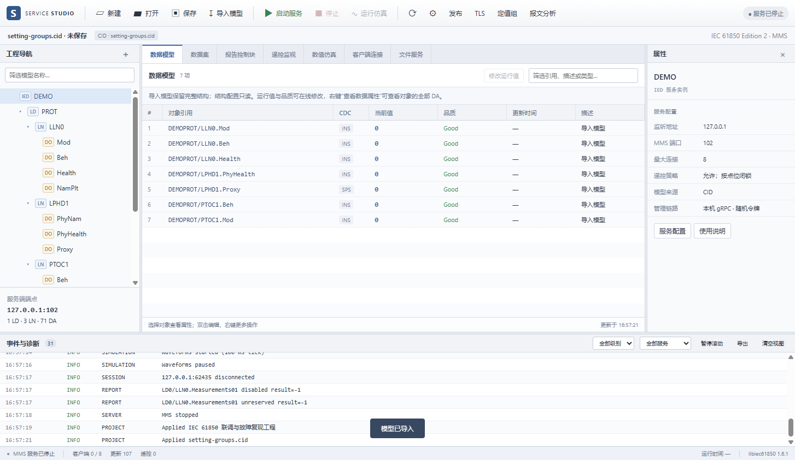

内置可编辑工程支持 MV、SPS、INS、SPC 和 DPC。可以配置点位初值、品质、描述、控制模型和仿真参数，也可以建立数据集及 URCB/BRCB。导入模型以保持原始结构为主，结构只读；其中具有标准 value/q/t 结构的受支持对象可以在线更新运行值。

### MMS 服务与运行监视

C++ 后端通过 libiec61850 创建真实 IED 模型并监听 MMS TCP 端口。服务配置支持指定本机 IPv4 地址、1–65535 端口、1–32 个客户端连接，以及是否允许远方控制。运行界面持续显示：

- 服务状态、启动时间和协议库版本；
- 已连接客户端及连接时间；
- 点位实时值、品质、时间戳和闭锁状态；
- 报告启用状态、所有者和事件计数；
- 在线更新、控制操作和发布统计；
- 运行事件与错误信息。

工程结构只能在服务停止时修改。服务运行后，在线改值作用于 C++ 运行模型，不会覆盖工程中的初始值。这使工程配置与一次联调会话中的临时状态保持清晰边界。

### 数据集与报告

数据集可以引用同一逻辑设备中的点位，并向 MMS 客户端公开值、品质和时间属性。除工程预定义数据集外，服务也支持客户端动态数据集操作。

报告控制块支持 URCB 和 BRCB，可配置数据集引用、数据变化、品质变化、数据更新、周期和 GI 触发位，以及 `IntgPd`、`BufTm` 和 `ConfRev`。报告由客户端保留和启用。客户端发起 GI 或数据满足触发条件后，服务端生成相应报告；工作区同步显示报告所有者、启用状态及累计事件数。

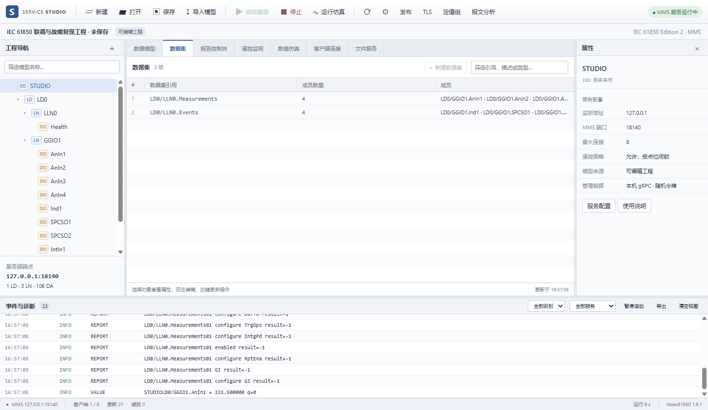

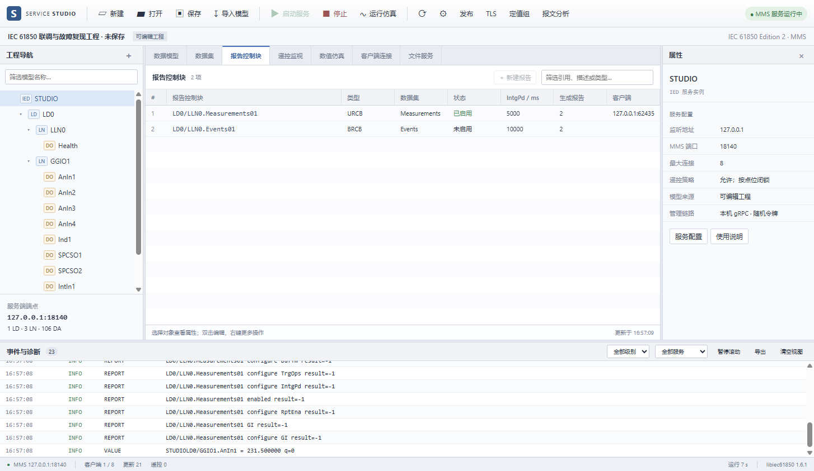

### 遥控处理

SPC 和 DPC 对象支持 IEC 61850 的四种控制模型：直接普通、SBO 普通、直接增强和 SBO 增强。控制路径区分选择、执行、取消、检查和状态更新，并提供工程级“允许远方控制”开关和点位级闭锁状态。

所有选择、执行和拒绝结果都会进入运行事件与本地审计记录。DPC 使用双点状态表达中间态、分位、合位和不确定态，界面按控制语义处理，而不是把它当作普通布尔量。

### 数值仿真

工程点位可以使用恒定、正弦、斜坡或方波模式产生变化值，并配置幅值和周期。仿真引擎以 100 ms 周期更新运行模型，可用于观察客户端读值、趋势以及数据变化报告。控制输出不会被波形自动覆盖。

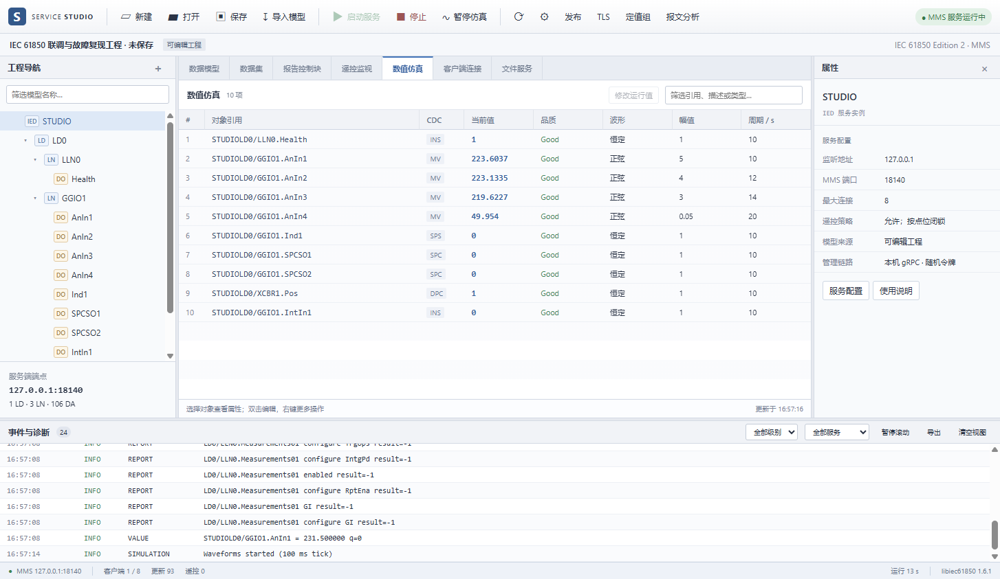

### 文件服务与审计

MMS 文件服务默认关闭。启用后，用户需要选择一个专用根目录，客户端只能通过服务访问该目录范围内的文件；工作区可以预览目录内容。

应用将运行事件写入本地 JSONL 审计日志，并支持筛选和 CSV 导出。单个日志文件达到 5 MB 后轮转，并保留一份历史文件。工程编辑期间还会写入恢复文件，异常退出后可以恢复未保存内容。

### TLS 安全通信

MMS 服务支持双向 TLS，配置项包括服务端证书、匹配私钥、可信客户端 CA、可选 CRL 和可选的指定客户端证书。默认允许 TLS 1.2 和 TLS 1.3，也可以限定为 TLS 1.3。

证书链、有效期、私钥匹配和吊销信息由原生后端验证。凭据加载失败时配置不会生效，也不会自动降级到明文连接。工程只保存凭据路径，不保存私钥内容。

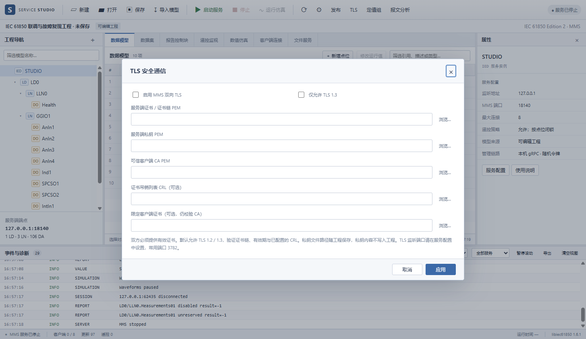

### GOOSE 与采样值发布

工程最多配置 16 个 GOOSE 或 SV 发布流。发布流可以手工创建，也可以从导入模型中的 GSE/SV 控制块生成配置模板。启用发布前需要选择以太网接口；Windows 环境需要 Npcap 提供链路层发送能力。

GOOSE 发布器根据数据变化推进 `stNum`，使用 `sqNum` 标识同一状态的重传，并在 `MinTime` 与 `MaxTime` 之间调整发送周期。SV 发布器使用 Windows 高精度等待定时器，支持每秒 1–4800 次采样，并统计因系统调度造成的漏期。发布线程先复制数据集值，再完成编码和发送，网络操作不会长期占用 IEC 模型锁。

SV 按数据集叶属性顺序编码通用值：布尔量占 1 字节，普通整数、枚举、FLOAT32 和 QUALITY 占 4 字节，INT64、FLOAT64 和 TIMESTAMP 占 8 字节。发布器不执行 9-2LE 固定比例换算，`smpSynch` 为 0，表示没有外部时钟同步。

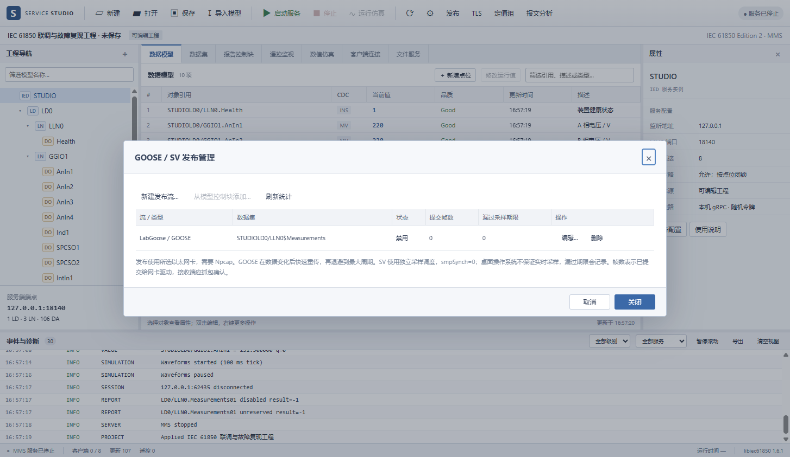

### 定值组

对于包含 SGCB、SG 和 SE 属性的模型，Service Studio 可以查看各定值银行、编辑定值并切换激活组。MMS 客户端可按 `EditSG → SE 写入 → CnfEdit → ActSG` 流程执行相同操作。

已确认的值按 MMS BER 类型保存到应用数据目录中的 `.banks` 文件。提交采用临时文件、刷盘和原子替换；只有持久化成功后才更新内存状态。客户端已预约编辑时，桌面端不会绕过该预约直接改写。

## 报文抓取、分析与回放

“报文抓取与分析”是独立窗口，可导入 PCAP、PCAPNG 和 CAP 文件，也可以选择网卡进行实时抓取。窗口提供 BPF 捕获过滤器、Wireshark 显示过滤器、非标准明文 MMS 端口配置、分页报文列表、TCP 会话、协议树、十六进制字节和请求/响应关联。

分析引擎以 TShark 完成 TCP 重组以及 TPKT、COTP、表示层、ASN.1 BER 和 MMS 解码。报告解析会结合同一关联中已经观察到的数据集定义、成员顺序、包含位和原因字段；缺失映射、分段不完整、访问失败或截断的数据会保留为未知，不会使用当前工程模型补全捕获证据。

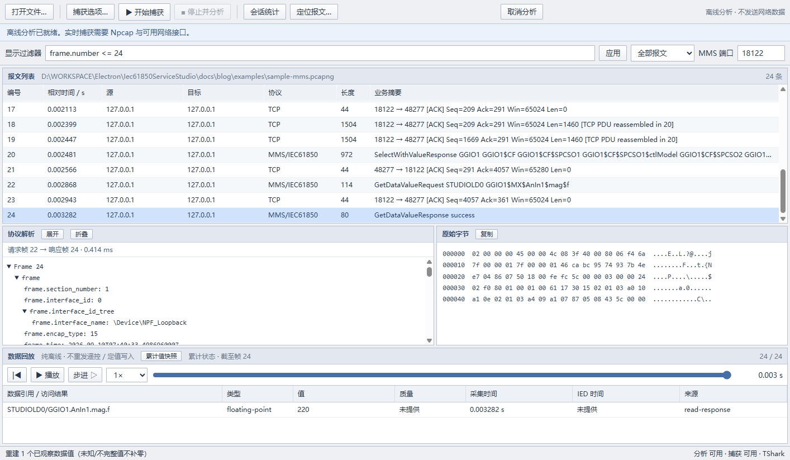

成功的 Read 响应和完整 Report 可以形成观察值时间线。用户可以播放、暂停、逐步前进、改变倍率、跳转到指定帧，或重建截止某帧的累计值快照。Write 只作为写入意图显示，不会被当作设备实际状态。

回放默认完全离线。若要把捕获值注入正在运行的本机仿真 IED，用户必须手工建立捕获引用与工程测量点的一对一映射并明确确认。主进程会重新读取目标帧，只接受完整、可回放、引用已解析且 FC 为 ST/MX 的安全标量；遥控、任意写请求、未知引用和不完整值都不会注入。

实时捕获最长一小时或 256 MiB，导入文件最大 2 GiB。报文元数据与语义记录使用临时磁盘索引，界面只保留有界分页缓存，适合浏览大文件。TLS 密文在没有解密材料时只作为加密流量展示。

## AI 学习与诊断

报文分析窗口集成 DeepSeek 助手。四套基础课程和客观练习可离线使用，覆盖 MMS Read、TCP ACK、TCP 重组和报告机制。配置 API Key 后，还可以解释选中帧或协议字段、跟踪 MMS 请求与响应、使用自然语言查找相关报文、根据读数和品质信息组织诊断结论、扫描指定引用的数据跳变，以及汇总 TCP 断连与重连线索。

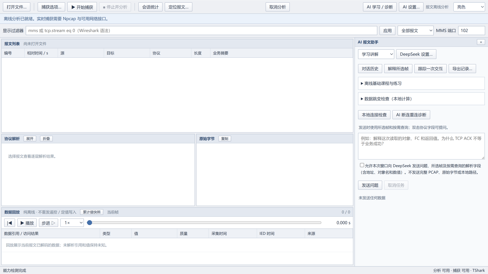

云端分析要求用户选择并确认发送范围。发送内容由问题、知识卡以及按需提取的解析字段组成，不包含完整 PCAP、原始帧字节或本地文件路径。模型只能提出解释和显示过滤建议，不能启动抓包、执行命令、遥控设备、修改定值或写入回放值。

API Key 由 Electron `safeStorage` 使用 Windows 用户凭据加密保存，不具备系统加密能力时拒绝落盘。已保存的 Key 不会在设置窗口中回显，连接测试只发送固定测试问题。

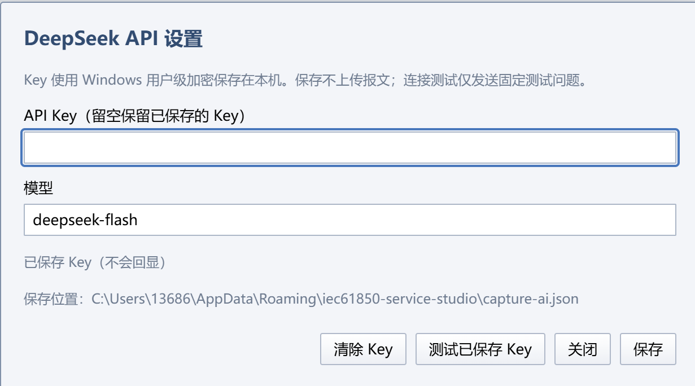

AI 答案在独立窗口中显示，支持 Markdown、表格、代码块、证据帧跳转、复制和导出。每次问答的状态、答案、有限证据快照、模型和 token 用量存入本地历史，可搜索、分页、重新打开和删除；历史中不保存 API Key，也不复制完整抓包文件。

长回答使用较大的生成预算。模型因长度停止时，应用会基于相同证据自动重试一次；若仍无法生成完整结果，则保存并展示带有明确状态的未完成草稿。

## 软件架构


系统由四个相互隔离的运行部分组成。

### Electron 桌面层

主进程管理窗口、原生菜单、工程文件、最近项目、恢复文件、审计日志、主题和后端生命周期。渲染进程通过开启 `contextIsolation` 和沙箱的 preload 暴露有限命令，不直接获得文件系统或进程执行能力。IPC 会验证窗口、主 frame 和页面来源。

主工作区包含模型树、虚拟表格、属性弹窗、点位/数据集/报告编辑器、TLS/发布/定值对话框和运行事件区域。固定行高的可见区渲染使模型树和表格可以处理最多 10,000 个工程点位。面板尺寸与亮色、暗色或跟随系统的主题偏好会在本地保存；主题在主窗口、捕获窗口、AI 答案和历史窗口之间同步。

### 本机管理平面

Electron 启动 `iec61850-service-backend.exe` 后，后端只在 `127.0.0.1` 的随机端口开放 gRPC 管理服务，并生成一次性随机令牌。每次 RPC 都必须携带该令牌。管理接口包括应用工程、启停服务、在线更新、仿真控制、状态快照、模型读取、网卡枚举、定值读取和定值修改。

这个随机管理端口只供桌面应用控制本机后端，与对外提供 IED 服务的 MMS 端口无关。桌面退出时会先请求后端正常停止，超时后再终止子进程。

### C++ IEC 61850 引擎

后端使用 C++17 和 libiec61850 1.6.1。`ServerEngine` 负责 IED 生命周期和运行状态，模型、控制、TLS、定值和以太网发布分别由专门模块管理。

| 模块 | 职责 |
|---|---|
| `server_engine.*`、`engine_operations.cpp` | 工程应用、服务启停、在线更新、仿真和状态快照 |
| `model_builder.cpp` | 动态模型、数据集、报告以及导入 CFG 的运行接线 |
| `model_browser.cpp` | 遍历模型并输出对象引用、属性元数据和发布模板 |
| `control_handlers.cpp` | 连接事件、报告状态和遥控选择/执行处理 |
| `project_validation.cpp` | 工程结构、参数范围和对象引用校验 |
| `tls_context.*` | TLS 资源、证书链与密钥检查 |
| `setting_store.*` | 定值银行、BER 值和持久化事务 |
| `publisher_service.*`、`publisher_model.cpp` | GOOSE/SV 配置、调度、编码和状态统计 |

生命周期操作、IEC 模型访问和发布统计使用不同锁域。关闭工程时先停止发布线程和 MMS 服务，再释放回调、IED、模型和 TLS 资源；应用工程失败时清理已创建的资源并保持未配置状态。

### 独立报文分析进程

Electron 不直接加载原生分析 DLL。打开分析窗口时，它启动 `capture-helper.exe`，辅助进程通过版本化 C ABI 加载 `iec61850-capture.dll`，并使用 JSONL 请求/响应协议与桌面窗口通信。TShark 和 Dumpcap 由辅助进程管理，运行在隐藏的 Windows Job 中，窗口关闭即可取消任务并回收整个进程树。

报文分析组件是可选资源。它缺失、超时或退出时，主工作区、工程编辑和 MMS 服务仍可继续使用。

## 使用方式

完成一次典型联调可以按以下顺序进行：

1. 新建工程，或从“文件 → 导入模型”加载 ICD、CID、SCD、IID 或 CFG。
2. 在服务配置中设置监听地址、MMS 端口、最大连接数和远方控制策略。
3. 按需配置 TLS、文件服务、GOOSE/SV 发布流和定值组。
4. 使用 `F5` 启动服务，让 IEC 61850 客户端连接配置的地址和端口。
5. 在工作区观察会话、读值、报告和控制事件；使用 `F6` 开启或停止数值仿真。
6. 需要定位通信问题时，打开报文分析窗口，导入抓包或选择网卡实时捕获，再查看会话、事务、协议字段和观察值时间线。

源码运行命令如下：

```powershell
cd D:\WORKSPACE\Electron\Iec61850ServiceStudio
npm install
npm run build:backend
npm run build:capture
npm start
```

构建需要 Node.js、Visual Studio 2022 C++ 工具链、CMake、Ninja，以及提供 gRPC 和 Protobuf 的 vcpkg。主 MMS 功能不依赖 Npcap；只有 GOOSE/SV 链路层发布和实时抓包需要系统安装 Npcap。离线报文分析使用应用附带的 Wireshark 命令行运行时。

执行 `npm run dist` 可生成 NSIS 安装包和 ZIP 目录便携版。便携版需要完整解压后运行，并保留同目录的 DLL 与 `resources` 资源。

## 技术范围

Service Studio 面向工程联调和协议行为验证。MMS、报告、遥控、TLS、GOOSE、SV、定值组和报文分析均由实际代码路径实现，其范围有明确约束：

- 产品不提供 IEC 61850 一致性认证结论，也不替代保护装置或实时过程总线测试设备；
- SV 使用通用数据集编码，没有 PTP 或硬件时钟同步，也不提供实时操作系统保证；
- TLS 提供双向证书验证，不包含完整的 IEC 62351 角色权限体系；
- 导入模型不是图形化 SCL 编辑器，不提供 SCL 往返导出；
- 在线编辑集中在 MV、SPS、INS、SPC 和 DPC 的标准值结构，遥控执行集中在 SPC 和 DPC；
- 报文回放重建已观察值，不重发原始 TCP、控制命令或报告控制块操作；
- AI 功能用于整理证据和辅助解释，最终工程判断仍以协议字段、设备配置和现场条件为准。

Service Studio 将可配置的 IED 服务、可观察的运行状态和可追溯的通信证据组织成一个完整的本地桌面工作流。
